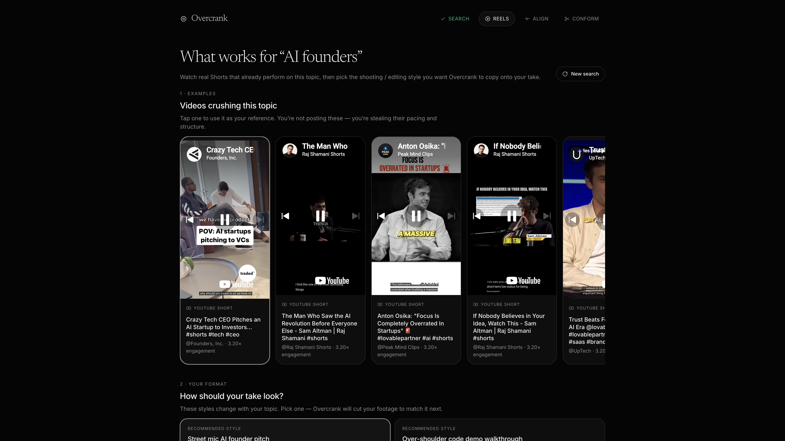
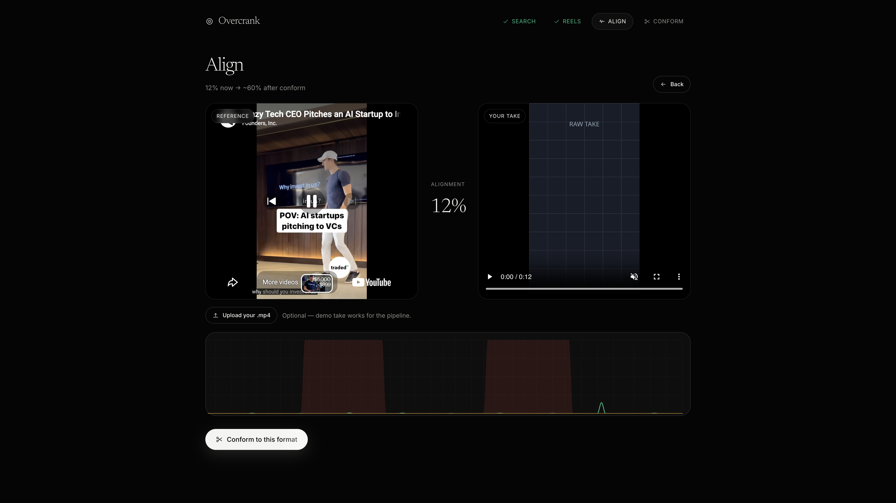

# Overcrank

Built by **Shehryar Hassan** · **Hack the Feed finalist** — format arbitrage for short-form video.

Creators don’t fail because they can’t film. They fail because they copy the *wrong* cut. Overcrank finds Shorts that already work for a topic, scores the shooting/edit style (yield vs saturation), aligns your raw take to that format’s physics, then hands you a Compound pack to finish the edit.

<p align="center">
  
</p>

<p align="center">
  
</p>

<p align="center">
  
</p>

## What I solved

Short-form advice is usually vibes (“hook faster”). Overcrank makes the format measurable:

1. **Search a topic** → surface real Shorts crushing that query  
2. **Pick a format** → high-yield / low-saturation styles (street mic, desk, split-cam, over-shoulder)  
3. **Align** → compare your take to the reference (cut density, dead air, focal push)  
4. **Conform** → auto-trim + punch-ins, then download a **Compound** pack (video + brief + starter timeline)

The gap we closed: *inspiration → editable project*, not another “copy this caption” tool.

## Sponsor tools

| Sponsor | How Overcrank uses it |
|---|---|
| **Oriane** | Visual / yield index for format cards (saturation + engagement physics) |
| **Compound.mov** | Final edit surface — zip pack with video, `BRIEF.md`, starter `index.tsx` |
| **Anthropic (Claude)** | Topic → format discovery + brief polish |
| **GMI Cloud** | Optional OpenAI-compatible inference |
| **Lovable** | Optional workspace API hooks |

Local engines on the FastAPI side: **OpenCV**, **PySceneDetect**, **auto-editor**, **FFmpeg**.

## Stack

- **FastAPI** — discovery, telemetry compare, conform, Compound handoff  
- **React (Vite)** — Search → Reels → Align → Conform studio  
- **Keys** — server-side only in `backend/.env` (never committed)

## Secrets (do not push)

Real keys live in `backend/.env` only. That file is **gitignored**.

```bash
cp backend/.env.example backend/.env
# paste keys locally — never commit .env
```

| Variable | Required | Purpose |
|---|---|---|
| `DEMO_MODE` | No | `1` = fixtures (safe crowd default) |
| `YOUTUBE_API_KEY` | No | Live Shorts search |
| `ORIANE_API_KEY` | No | Live format yield |
| `ANTHROPIC_API_KEY` | No | Topic formats + prompt polish |
| `GMI_API_KEY` | No | GMI inference |
| `LOVABLE_API_KEY` | No | Lovable workspace |
| `COMPOUND_API_KEY` | No | Optional; pack works without it |

## Run locally

```bash
make install
make demo          # local reels + warm conform
make backend       # :8000
make frontend      # :5173
```

Open `http://127.0.0.1:5173`. With `DEMO_MODE=1`, the studio runs on fixtures without live APIs.

## Cursor ↔ Compound MCP

`.cursor/mcp.json` exposes:

- `scan_format_yield_matrix`
- `discover_topic_shortform`
- `audit_raw_take_telemetry`
- `compare_rig_alignment`
- `conform_footage_and_export_compound_edl`
